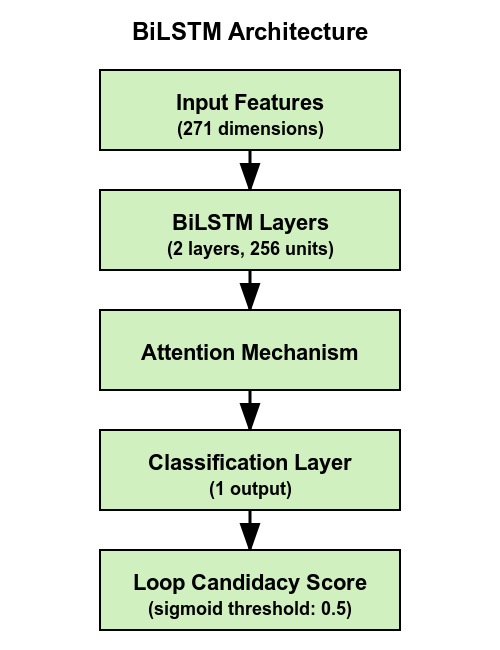
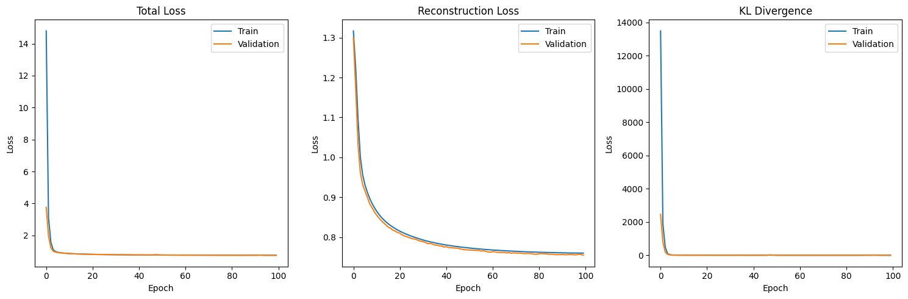

# dl4am-cvae-bilstm

Loop-aware audio generation in PyTorch: a BiLSTM-with-attention classifier learns what makes a drum recording *loopable*, and its confidence signal steers latent-space manipulation of a conditional VAE trained on mel-spectrograms — so the combined pipeline generates audio biased toward seamless loops. Coursework project for Deep Learning for Audio & Music (ECS7013P) at Queen Mary University of London.

## The two models

| Model | Data | Best run |
|---|---|---|
| BiLSTM + self-attention loop-candidacy classifier | Groove MIDI drum corpus, beat-synchronous features | **val F1 0.977** (2 layers, hidden 128, dropout 0.3) |
| Conditional VAE over mel-spectrograms | FMA-Small | latent dim 32, lr 1e-4, β = 0.001 |

**Combined inference:** encode audio with the CVAE, nudge the latent vector along directions that raise the BiLSTM's loop-confidence score, decode, and render back to audio with Griffin-Lim.

## Notebook

Everything lives in [`DL4AM_Coursework_Segall.ipynb`](DL4AM_Coursework_Segall.ipynb) (~8,500 lines): dataset classes for FMA and Groove MIDI, both model definitions, training loops with hyperparameter search for each model, evaluation/visualization, and the combined CVAE + BiLSTM inference. It was written for Colab — datasets are expected under a single Drive root (`DL4AM_datasets`); change `drive_root` in section 2.1 to point elsewhere. Quick-test flags in section 2.5 let you smoke-test the whole pipeline on a small subset first.

## Checkpoints & metrics

Trained CVAE checkpoints are attached to the [v1.0 release](../../releases/tag/v1.0) (too big for the repo). Hyperparameters and scores for the best runs of both models are in [`metrics/`](metrics/). The BiLSTM checkpoint is small enough to retrain from the notebook in a few hours on a T4.

## Report

[`report.pdf`](report.pdf) — IEEE-style write-up: motivation, architectures, training setup, hyperparameter searches, evaluation, and the combined-system results.
